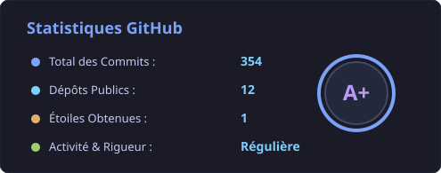
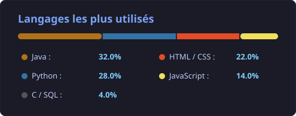

# Yanis Nedjar

<div align="center">
  
  <br/><br/>

  <!-- Dynamic Typing Header Effect -->
  <a href="https://github.com/NedjarYanis">
    
  </a>
  <br/><br/>

  <p align="center">
    <a href="https://linkedin.com/in/yanis-nedjar-226727304">
      
    </a>
    &nbsp;
    <a href="mailto:yanisnedjar5@gmail.com">
      
    </a>
    &nbsp;
    <a href="https://www.google.com/maps/place/Orleans">
      
    </a>
    &nbsp;
    
  </p>
</div>

<br/>

### Terminal Interactif

<div align="center">
  
</div>

<br/>

### À propos

Étudiant en 2ème année de **BUT Informatique (Parcours Réalisation d'applications)** à l'**IUT d'Orléans**.

Passionné par le développement logiciel et l'architecture web, je conçois des applications complètes et performantes en alliant rigueur technique (Java, Python, C, SQL, JavaScript), architecture MVC et modélisation logicielle (POO, diagrammes UML).

Je suis actuellement à la recherche d'un **stage conventionné en développement logiciel / web de 8 à 10 semaines**.

---

### Projets Mis en Avant

<table>
  <tr>
    <td width="50%" valign="top">
      <h3><a href="https://github.com/NedjarYanis/puissance4">Puissance 4 JavaFX (MVC)</a></h3>
      <p>Jeu de plateau complet en Java avec modélisation orientée objet rigoureuse, diagrammes de classes UML, arbre de scène et interface JavaFX dynamique.</p>
      <p><b>Stack :</b> Java 17+, JavaFX, CSS, POO, Architecture MVC, Tests JUnit</p>
      <p><a href="https://github.com/NedjarYanis/puissance4"><b>Consulter le code source →</b></a></p>
    </td>
    <td width="50%" valign="top">
      <h3><a href="https://github.com/NedjarYanis/atelier-kibako-flask">Atelier Kibako — E-Commerce Flask</a></h3>
      <p>Boutique web complète avec gestion de catalogue, persistance MariaDB / SQLAlchemy 2.x, simulateur acoustique Web Audio API et panneau de configuration.</p>
      <p><b>Stack :</b> Python 3.11+, Flask 3.x, SQLAlchemy 2.x, MariaDB / SQLite</p>
      <p><a href="https://github.com/NedjarYanis/atelier-kibako-flask"><b>Consulter le code source →</b></a></p>
    </td>
  </tr>
  <tr>
    <td width="50%" valign="top">
      <h3><a href="https://github.com/NedjarYanis/mon-generateur-qr">Générateur QR Pass</a></h3>
      <p>Application web Flask couplée à un moteur d'automatisation headless Selenium et conteneurisée avec Docker pour la génération sécurisée de passes d'accès.</p>
      <p><b>Stack :</b> Python, Flask, Selenium, Docker, Automatisation, HTML5 / CSS3</p>
      <p><a href="https://github.com/NedjarYanis/mon-generateur-qr"><b>Consulter le code source →</b></a></p>
    </td>
    <td width="50%" valign="top">
      <h3><a href="https://github.com/NedjarYanis/R3.04-proj01-tetris">Tetris Pygame</a></h3>
      <p>Reconception et implémentation du jeu culte Tetris avec gestion précise des collisions, boucle de rendu fluide à 60 FPS et rotation des tétrominos.</p>
      <p><b>Stack :</b> Python, Pygame, Algorithmique, PEP 8 / YAPF</p>
      <p><a href="https://github.com/NedjarYanis/R3.04-proj01-tetris"><b>Consulter le code source →</b></a></p>
    </td>
  </tr>
  <tr>
    <td width="50%" valign="top">
      <a href="https://github.com/NedjarYanis/pixelcom">
        
      </a>
      <h3><a href="https://github.com/NedjarYanis/pixelcom">PixelCom — Agence Digitale</a></h3>
      <p>Site vitrine responsive pour une agence digitale spécialisée en communication web, identité visuelle et optimisation SEO.</p>
      <p><b>Stack :</b> HTML5, CSS3 Moderne, JavaScript Vanilla, Responsive Design</p>
      <p><a href="https://nedjaryanis.github.io/pixelcom/"><b>Consulter le site en ligne →</b></a></p>
    </td>
    <td width="50%" valign="top">
      <a href="https://github.com/NedjarYanis/index-boulange">
        
      </a>
      <h3><a href="https://github.com/NedjarYanis/index-boulange">La Bonne Baguette — Artisanat</a></h3>
      <p>Site vitrine pour une boulangerie artisanale avec catalogue de spécialités, horaires et formulaire de contact interactif.</p>
      <p><b>Stack :</b> HTML5, CSS3, JavaScript Vanilla</p>
      <p><a href="https://nedjaryanis.github.io/index-boulange/"><b>Consulter le site en ligne →</b></a></p>
    </td>
  </tr>
</table>

---

### Spécifications & Approches Techniques

<details>
  <summary><b>Architecture Logicielle &amp; Patrons de Conception (MVC &amp; POO)</b></summary>
  <br/>
  
  Sur l'ensemble de mes projets (qu'il s'agisse de l'application JavaFX **Puissance 4** ou des plateformes web **Flask**), je veille à une séparation stricte des responsabilités :
  - **Modèle** : Logique métier pure, gestion de la persistance (SQLAlchemy / JDBC) et invariants applicatifs.
  - **Vue** : Interfaces déclaratives ou graphiques (templates Jinja2, scènes JavaFX) isolées de la logique métier.
  - **Contrôleur** : Routage, validation des entrées et orchestration des interactions.
  - **Modélisation UML** : Conception préalable systématique avec diagrammes de cas d'utilisation, de séquence et de classes.
</details>

<details>
  <summary><b>Qualité de Code, Tests &amp; Automatisation</b></summary>
  <br/>
  
  - **Tests Unitaires** : Validation systématique de la logique métier via **JUnit** en Java et suites de tests Python.
  - **Qualité &amp; Formatage** : Respect strict des conventions de style (PEP 8 avec vérification YAPF, normes de codage Java).
  - **Conteneurisation** : Images Docker reproductibles intégrant dépendances système et pilotes headless (ex: Google Chrome pour Selenium).
</details>

<details>
  <summary><b>Infrastructure Réseau &amp; Systèmes</b></summary>
  <br/>
  
  - **Topologies Réseau** : Modélisation et déploiement sous simulateur **GNS3** avec environnements Linux.
  - **Routage &amp; Sécurité** : Configuration du routage dynamique **OSPF**, mise en place de relais **DHCP** et segmentation par listes de contrôle d'accès (**ACL**).
  - **Serveurs Web** : Intégration et sécurisation de reverse proxies **Nginx** au sein de zones démilitarisées (**DMZ**).
</details>

---

### Compétences Techniques

```text
Langages           │ Java, Python, C, SQL, JavaScript, HTML5, CSS3, Bash
Frameworks & Libs  │ Flask, JavaFX, SQLAlchemy, Bootstrap, Tailwind CSS, Pygame, JUnit
Bases de données   │ MySQL, MariaDB, SQLite, Firebase
Outils & Réseau    │ Git, GitHub, Docker, Maven, Linux, VS Code, Nginx, GNS3, OSPF, DHCP, ACL
Méthodes & Gestion │ Architecture MVC, Modélisation UML (Cas d'utilisation, Séquence, Classes), POO
```

---

### Activité & Statistiques

<div align="center">
  <a href="https://github.com/NedjarYanis">
    
  </a>
  <br/><br/>

  
  
  
</div>

---

<div align="center">
  <sub>Portfolio et profil maintenus par Yanis Nedjar — Mis à jour en 2026</sub>
</div>
