# Yanis Nedjar

<div align="center">
  
  <br/><br/>

  <!-- Dynamic Typing Header Effect -->
  <a href="https://github.com/NedjarYanis">
    
  </a>
  <br/><br/>

  [](https://linkedin.com/in/yanis-nedjar-226727304)
  [](mailto:yanisnedjar5@gmail.com)
  [](https://www.google.com/maps/place/Orleans)
  [](#)
</div>

<br/>

### Terminal Interactif

<div align="center">
  
</div>

<br/>

### À propos

Étudiant en 2ème année de **BUT Informatique (Parcours Réalisation d'applications)** à l'**IUT d'Orléans**.

Passionné par la conception logicielle et l'architecture web, j'allie rigueur technique (Java, Python, TypeScript, SQL) et gestion de projet collaborative (modélisation UML, architecture MVC, revues de code sous Git). J'ai piloté plusieurs projets universitaires en équipe de 4 personnes de l'analyse du besoin jusqu'à la livraison finale.

Je suis actuellement à la recherche d'un **stage conventionné en développement logiciel / web de 8 à 10 semaines**.

---

### Projets Mis en Avant

<table>
  <tr>
    <td width="50%" valign="top">
      <h3><a href="https://github.com/NedjarYanis/hub-hair">BarberGlass (Hub-Hair)</a></h3>
      <p>Application mobile de réservation pour salons de coiffure et barbiers avec interface glassmorphism, géolocalisation et authentification en temps réel.</p>
      <p><b>Stack :</b> React Native, Expo, TypeScript, Firebase Auth &amp; Firestore</p>
      <p><a href="https://nedjaryanis.github.io/hub-hair/"><b>Explorer la démo en ligne →</b></a></p>
    </td>
    <td width="50%" valign="top">
      <h3><a href="https://github.com/NedjarYanis/cv-leclerc">Portfolio 3D Interactif</a></h3>
      <p>Expérience web immersive en 3D avec caméra dynamique plongeante, environnement volumétrique et animations réactives au curseur.</p>
      <p><b>Stack :</b> React 19, Three.js, React Three Fiber (R3F), Tailwind CSS, Framer Motion</p>
      <p><a href="https://nedjaryanis.github.io/cv-leclerc/"><b>Explorer le rendu 3D →</b></a></p>
    </td>
  </tr>
  <tr>
    <td width="50%" valign="top">
      <h3><a href="https://github.com/NedjarYanis/puissance4">Puissance 4 JavaFX (MVC)</a></h3>
      <p>Jeu de plateau complet en Java avec modélisation orientée objet rigoureuse, diagrammes de classes UML, arbre de scène et interface JavaFX dynamique.</p>
      <p><b>Stack :</b> Java 17+, JavaFX, CSS, POO, Architecture MVC</p>
    </td>
    <td width="50%" valign="top">
      <h3><a href="https://github.com/NedjarYanis/mon-generateur-qr">Générateur QR Pass</a></h3>
      <p>Application web Flask couplée à un moteur d'automatisation headless Selenium et conteneurisée avec Docker pour la génération sécurisée de passes d'accès.</p>
      <p><b>Stack :</b> Python, Flask, Selenium, Docker, HTML5 / CSS3</p>
    </td>
  </tr>
  <tr>
    <td width="50%" valign="top">
      <h3><a href="https://github.com/NedjarYanis/R3.04-proj01-tetris">Tetris Pygame</a></h3>
      <p>Reconception et implémentation du jeu culte Tetris avec gestion précise des collisions, boucle de rendu fluide et rotation des tétrominos.</p>
      <p><b>Stack :</b> Python, Pygame, Algorithmique</p>
    </td>
    <td width="50%" valign="top">
      <h3>Projet Couple SAE 3.01c</h3>
      <p>Plateforme web collaborative complète : gestion financière (dépenses communes, calcul de remboursement), calendrier partagé et répartition des tâches ménagères.</p>
      <p><b>Stack :</b> Python, Flask, SQLAlchemy, MySQL / MariaDB, Bootstrap 5</p>
    </td>
  </tr>
</table>

---

### Spécifications & Approches Techniques

<details>
  <summary><b>Architecture Logicielle &amp; Patrons de Conception (MVC &amp; POO)</b></summary>
  <br/>
  
  Sur l'ensemble de mes projets (qu'il s'agisse de l'application JavaFX **Puissance 4** ou de la plateforme web **Flask**), je veille à une séparation stricte des responsabilités :
  - **Modèle** : Logique métier pure, gestion de la persistance (SQLAlchemy / JDBC) et invariants applicatifs.
  - **Vue** : Interfaces déclaratives ou graphiques (templates Jinja2, scènes JavaFX, JSX) isolées de la logique métier.
  - **Contrôleur** : Routage, validation des entrées et orchestration des interactions.
  - **Modélisation UML** : Conception préalable systématique avec diagrammes de cas d'utilisation, de séquence et de classes.
</details>

<details>
  <summary><b>Qualité de Code, Tests &amp; Automatisation</b></summary>
  <br/>
  
  - **Tests Unitaires** : Validation systématique de la logique métier via **JUnit** en Java et suites de tests Python.
  - **Qualité &amp; Formatage** : Respect strict des conventions de style (PEP 8 avec vérification YAPF, ESLint sous React/TypeScript).
  - **Conteneurisation** : Images Docker reproductibles intégrant dépendances système et pilotes headless (ex: Google Chrome pour Selenium).
</details>

<details>
  <summary><b>Infrastructure Réseau &amp; Systèmes</b></summary>
  <br/>
  
  - **Topologies Réseau** : Modélisation et déploiement sous simulateur **GNS3** avec environnements Linux.
  - **Routage &amp; Sécurité** : Configuration du routage dynamique **OSPF**, mise en place de relais **DHCP** et segmentation par listes de contrôle d'accès (**ACL**).
  - **Serveurs Web** : Intégration et sécurisation de reverse proxies **Nginx** au sein de zones démilitarisées (**DMZ**).
</details>

---

### Compétences Techniques

```text
Langages           │ Java, Python, TypeScript, JavaScript, SQL, HTML5, CSS3, Bash
Frameworks & Libs  │ React, React Native, Expo, Flask, Three.js (R3F), JavaFX, SQLAlchemy, Bootstrap, Tailwind CSS, Pygame, JUnit
Bases de données   │ MySQL, MariaDB, Firebase
Outils & Réseau    │ Git, GitHub, Docker, Maven, Linux, VS Code, Nginx, GNS3, OSPF, DHCP, ACL
Méthodes & Gestion │ Architecture MVC, Modélisation UML (Cas d'utilisation, Séquence, Classes), Agile / Trello, Gantt
```

---

### Activité & Statistiques

<div align="center">
  
  
  
</div>

---

<div align="center">
  <sub>Portfolio et profil maintenus par Yanis Nedjar — Mis à jour en 2026</sub>
</div>
